# Journal de bord de l'étude de cas / Case study project log

**Binôme / Team members :**

- Bouchet Elisabeth
- Alves Mesquita José Vitor

Ce fichier commun accompagne les deux dépôts en séance et le rendu final. Quelques phrases précises suffisent à chaque étape. Conservez les états précédents lorsque vous le complétez. Vous pouvez rédiger vos réponses en français ou en anglais.

This shared file accompanies both checkpoints and the final submission. A few precise sentences are enough at each stage. Keep earlier entries when adding new ones. You may write your answers in French or English.

## Fin de la première séance / End of the first session

**Date :** 20/11/2026

**Essai exécuté et nom du CSV / Run completed and prediction CSV filename (`baseline` peut fournir les résultats globaux / may supply the overall results) :**

Méthode de départ : `baseline`. Deux pistes personnelles ont également été testées : une comparaison après lissage gaussien et un seuillage de Sauvola.

**À compléter :** noms exacts des essais et des fichiers CSV correspondant aux figures ci-dessous.

**Deux observations sur les images et les erreurs de la méthode de départ / Two observations about images and baseline errors :**

1. Les variations de luminosité et les ombres entraînent des erreurs d'identification.
2. Certaines voitures, notamment blanches, peuvent ne pas modifier suffisamment la moyenne d'intensité de la place pour être détectées.

La méthode de départ soustrait la moyenne d'intensité de la référence vide à celle de la place observée, puis compare la valeur absolue de cette différence à un seuil de décision. Cette mesure ne suffit pas à distinguer toutes les variations observées, comme le montre la matrice de confusion suivante.

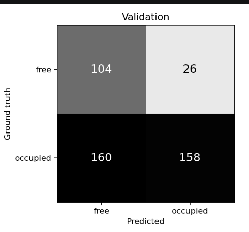

Convention des étiquettes : `1` signifie « place occupée » et `0` signifie « place libre ».

**Première proposition de chaîne et justification, consignée avant les essais / Initial pipeline proposal and justification, recorded before running trials :**

1. Sélectionner uniquement les places considérées à l'aide de leurs zones d'intérêt.
2. Lisser l'image pour essayer de diminuer l'impact des ombres.
3. Comparer la moyenne de chaque place à une valeur de référence ; envisager une comparaison sur les trois couleurs ou une moyenne locale dans la place.

### Observations ayant motivé les pistes de traitement

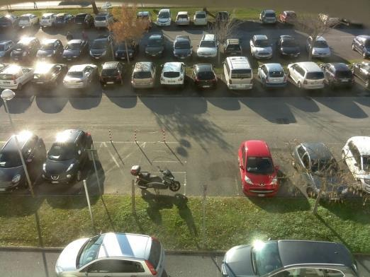

*Soleil.*

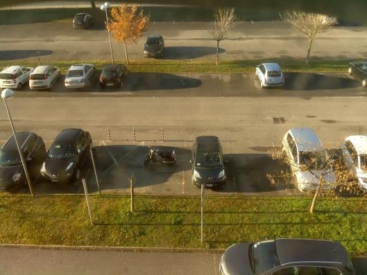

*Ombre.*

En observant notamment la place **204**, nous distinguons quatre principales sources de variation :

- l'environnement extérieur : passant, roue d'une voiture voisine, etc. ;
- le déplacement des ombres ;
- les réflexions du soleil ;
- les changements de luminosité liés à l'heure de la journée.

Les hypothèses envisagées sont les suivantes :

- utiliser un seuil en niveaux de gris pour supprimer les reflets et d'autres variations ; cette première piste a conduit à des erreurs ;
- utiliser le seuillage de Sauvola pour observer les variations locales et essayer d'en déduire la présence d'une voiture ;
- utiliser un filtrage gaussien pour atténuer certaines variations et le bruit ;
- utiliser un seuil de couleur pour observer l'apparition d'éléments colorés.

Nous souhaitons d'abord étudier les variations dues aux ombres et au soleil. Deux pistes ont été retenues pour les essais : une comparaison après lissages gaussiens et un seuillage de Sauvola. Nous envisageons de les combiner lors de la prochaine séance.

Repérage des images dans le jeu de données : `C` pour calibrage, `V` pour validation et `E` pour évaluation.
**Ce que nous avons effectivement codé et testé pendant la séance / Code actually written and tested during the session :**

### Comparaison après lissages gaussiens

Nous avons testé une approche fondée sur la différence entre l'image courante et la référence après lissage gaussien. Nous avons comparé plusieurs valeurs de sigma pour l'image courante et pour la référence afin d'observer leur effet sur les variations spatiales et le bruit.

Les analyses ont été effectuées sur des images converties en niveaux de gris. Après soustraction des images lissées, nous avons étudié la médiane des différences absolues dans chaque crop comme score possible. Les visualisations permettent également de comparer la moyenne et la médiane et d'examiner un seuil de décision.

Les essais de lissage se trouvent dans `test_blurring.py`. La méthode personnelle est conservée dans `pipeline_dog.py`, dans la fonction `predict()`.

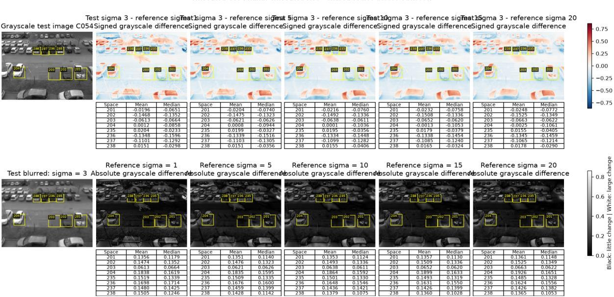

*Exemple de sortie de `test_blurring.py` : comparaison des valeurs de sigma, des différences signées et absolues, puis de la moyenne et de la médiane dans les places. Cette figure a servi à examiner l'effet du lissage et le choix d'un seuil.*

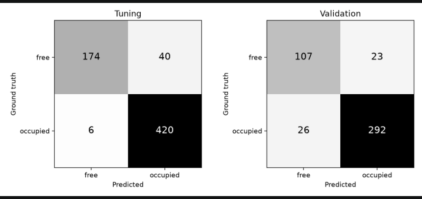

*Résultats de l'essai présenté dans le document source sur les ensembles de réglage et de validation. Le nom exact de l'essai et sa configuration restent à préciser.*

### Seuillage de Sauvola

Nous avons également testé le seuillage de Sauvola. Le code ci-dessous est repris du document source ; seule son indentation a été remise en forme.

```python
import numpy as np
from skimage import filters, color
from tools import crop

DECISION_THRESHOLD = 0.1


def predict(image, reference, box):
    """Return (score, decision) for one parking slot.

    The reference shows this slot empty. This baseline compares the mean of
    all three RGB channels. It does not account for shadows, lighting changes,
    or the spatial structure of a vehicle. Keep this method unchanged when
    comparing its results with those of your own pipeline.
    """
    current = crop(image, box)
    empty = crop(reference, box)
    current = color.rgb2gray(current)
    empty = color.rgb2gray(empty)

    # On évalue les valeurs de Sauvola.
    seuil_sauvola = filters.threshold_sauvola(
        current, window_size=41, k=0.2, r=0.5
    )
    masque_sauvola = current < seuil_sauvola

    # On fait un seuillage sur l'image de référence.
    empty_threshold = filters.threshold_sauvola(
        empty, window_size=41, k=0.2, r=0.5
    )
    # Ici, on a les pixels sombres qui existaient avant les voitures.
    empty_mask = masque_sauvola < empty_threshold

    # On ne garde que les pixels sombres qui n'existaient pas avant les voitures.
    new_pixels = masque_sauvola & ~empty_mask

    # On regarde la proportion de nouveaux pixels parmi tous les pixels présents.
    score = float(np.mean(new_pixels))
    print(score)

    decision = int(score > DECISION_THRESHOLD)
    return score, decision
```

Les étapes sont détaillées dans les commentaires. Les paramètres de Sauvola ont été repris du TP5a, car ils nous semblaient encore adaptés à la situation.

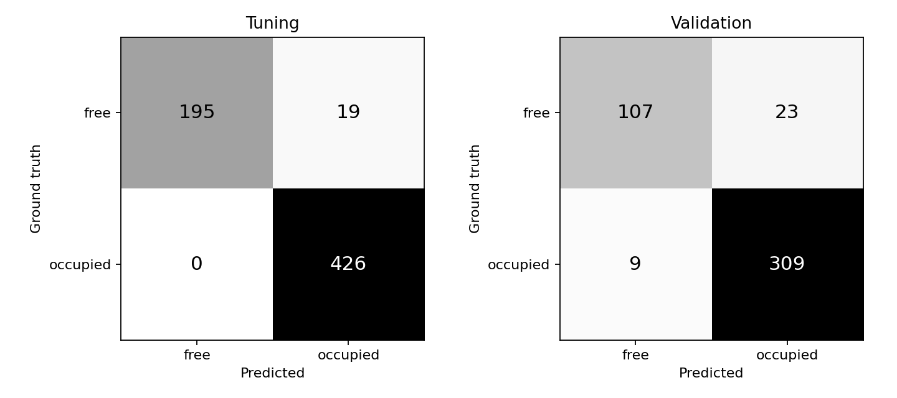

*Résultats de l'essai Sauvola sur les ensembles de réglage et de validation. Nous envisageons ensuite de modifier `DECISION_THRESHOLD` pour étudier son effet sur les résultats.*
**Fichier et fonction du premier traitement personnel, puis commande pour l'exécuter / File and function implementing the first personal processing step, followed by its execution command :**

- Comparaison des lissages et affichage des différences : `case_study/test_blurring.py`.
- Méthode gaussienne : fonction `predict()` dans `case_study/pipeline_dog.py`.
- Méthode de Sauvola : fonction `predict()` reproduite ci-dessus ; **fichier utilisé à préciser**.

Depuis le dossier `traitement-images/`, la visualisation des lissages se lance avec :

```sh
python case_study/test_blurring.py
```

**À compléter :** commande exacte utilisée pour reproduire chacun des essais et ses matrices de confusion.

Le code est également disponible dans le [dépôt du projet](https://github.com/Zezinoo/TraitmentImages).
**Figure montrant l'entrée et le résultat, et commentaire (`case_study/results/first-step.png`) / Figure showing the input and result, with an explanation (`case_study/results/first-step.png`) :**

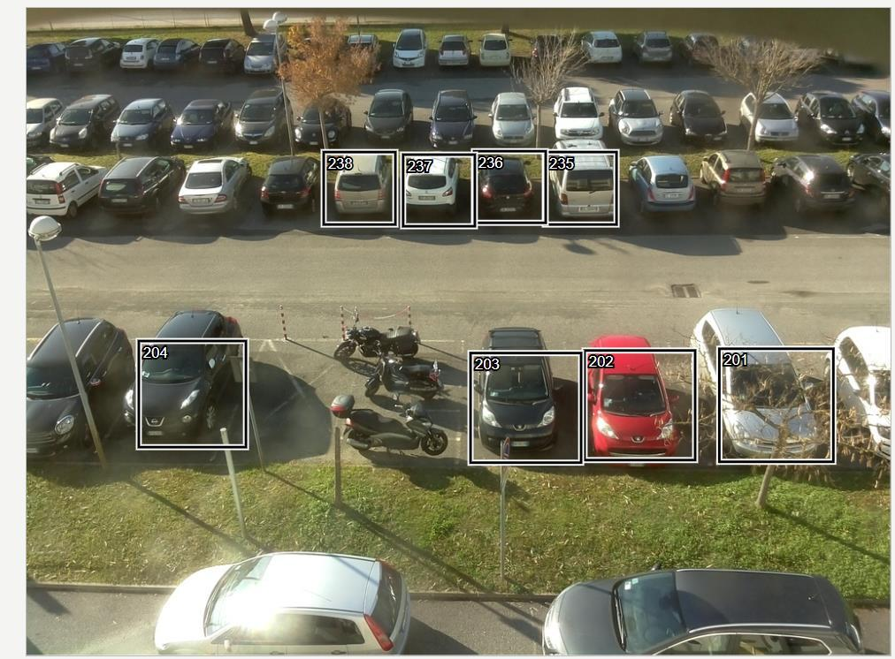

*Image **C012**, reprise du document source, avec les huit places repérées. La comparaison des lissages et des différences intermédiaires est présentée plus haut.*

**À compléter :** identifier précisément la méthode et l'essai ayant produit cette figure, puis fournir la figure d'entrée et de résultat demandée sous le nom `case_study/results/first-step.png`.
**Difficulté encore ouverte / Unresolved difficulty :**

Les variations de luminosité et les ombres restent difficiles à distinguer des changements liés à la présence d'une voiture. Certaines voitures noires se confondent également avec les variations sombres ou le bruit. Nous souhaitons poursuivre l'étude des seuils et envisager une combinaison des deux pistes à la prochaine séance.
La chaîne complète peut rester inachevée. Le premier dépôt demande un traitement personnel exécuté et commenté. Si vous n'avez pas pu l'exécuter ou produire sa figure, indiquez le blocage et déposez tout de même votre code.

The full pipeline may remain unfinished. Checkpoint 1 requires one personal processing step that has been run and discussed. If you could not run it or produce its figure, explain the difficulty and still submit your code.

## Fin de la seconde séance / End of the second session

ATTENTION : Les images de decision ne sont pas dans le fichier que va avec le compte rendu, mais elle sont disponibles sur https://github.com/Zezinoo/TraitmentImages

**Date :** 27/11/2026

**Essai exécuté et nom du CSV / Run completed and prediction CSV filename :**
diference_of_gaussians
diffrence_of_gaussians_mean
sauvola

**Étapes du prototype réellement exécutées, résultats intermédiaires et étapes manquantes / Prototype steps actually run, intermediate results, and missing steps :**

Pour le prototype des différences de gaussiennes (DoG), on a essayé d'abord, comme décrit dans la séance d'avant, d'explorer les valeurs possibles pour l'écart-type des noyaux gaussiens. En effet, on cherche pour l'image de référence un écart-type qui lisse les détails de basse fréquence en rapprochant la référence d'un bruit uniforme. On cherche aussi une valeur adaptée pour le noyau gaussien de l'image actuelle, celui-ci étant beaucoup plus petit pour enlever les fréquences spatiales qui se rapprochent du bruit. Avant tout ça, on a converti l'image de RGB en niveaux de gris.

On a fait des essais avec 20 px et 500 px, et finalement choisi 20 px pour avoir une meilleure performance. En regardant les valeurs avec le fichier test_blurring.py, on est arrivé à un DECISION THRESHOLD adapté de 0.11.

Pour le prototype du seuil de Sauvola, on a tenté de l'utiliser pour avoir une information locale sur les images et pourtant essayer de s'affranchir des effets d'illumination et d'ombre trop marqués. On a utilisé l'implémentation de la bibliothèque skimage. On a fait de telle sorte qu'on ne gardait que les pixels correspondant aux voitures, comme détaillé dans le code.

On a remarqué que, dans les deux cas, il y a des jours où le F1 score n'est pas bon, surtout parce que la valeur du recall n'était pas trop adaptée. Un jour comme ça, c'est le jour 2026-01-16, qui comprend les images V017-V024. On a un F1 score bas car on a des faux positifs dans ces images, notamment quand on a de l'humidité sur le sol.

Dans cette séance, on a essayé de lier les deux méthodes afin de voir si on pouvait se servir des forces des deux. Pour ça, on a pris finalement un score donné par la prédiction gaussienne, un score donné par la prédiction de Sauvola, et on prend comme score final une combinaison linéaire des deux.

```python
def predict(image, reference, box):
    gaussian_result = predict_Gaussian(image, reference, box)
    sauvola_result = predict_Sauvola(image, reference, box)

    if gaussian_result[1] == sauvola_result[1]:
        final_decision = gaussian_result[1]
        final_score = sauvola_result[0]
    else:
        final_score = (gaussian_result[0] + sauvola_result[0]) / 2
        final_decision = int(final_score > DECISION_THRESHOLD)

    return final_score, final_decision
```

En effet, ce que ça fait, c'est que, si les deux décisions sont en accord, on prend le score de Sauvola ; sinon, on prend le rapport moyen des décisions et on le compare avec le DECISION_THRESHOLD.

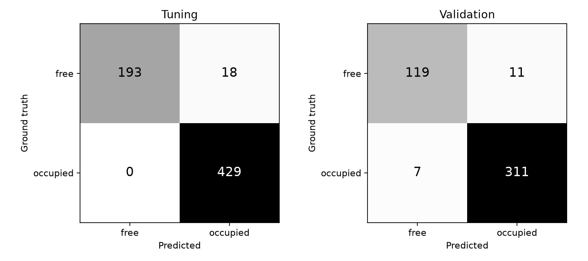

On voit qu'avec cette méthode, on est arrivé à une accuracy globale de 95.98 %, avec les métriques suivantes :

| Metric | Value |
|---|---:|
| Precision | 96.58% |
| Recall | 97.80% |
| F1 score | 97.19% |
| Accuracy | 95.98% |

**Masque et mesure, s'ils sont disponibles / Mask and measurement, if available :**

On a utilisé un masque de Sauvola.

```python
    seuil_sauvola = filters.threshold_sauvola(
        current, window_size=41, k=0.2, r=0.5
    )
    masque_sauvola = current < seuil_sauvola

    # On fait un seuillage sur l'image de référence.
    empty_threshold = filters.threshold_sauvola(
        empty, window_size=41, k=0.2, r=0.5
    )

    # Ici, on a les pixels sombres qui existaient avant les voitures.
    empty_mask = empty < empty_threshold

    # On ne garde que les pixels sombres qui n'existaient pas avant les voitures.
    new_pixels = masque_sauvola & ~empty_mask
```

**Commande reproduisant une étape exécutée et figure jointe (par exemple `case_study/results/checkpoint-2.png`) / Command reproducing a completed step and attached figure (for example `case_study/results/checkpoint-2.png`) :**

Pour faire tourner le pipeline, on a légèrement modifié le fichier run.py afin d'ajouter une option joint pour la méthode du pipeline. Cette méthode joint correspond donc à l'alliance entre Sauvola et le DoG. Du coup, pour faire tourner le pipeline, on fait :

```python
python run.py --method joint
```

Donc, on peut regarder les résultats sur une image et ensuite les métriques comme la matrice de confusion, l'accuracy par jour et par météo.

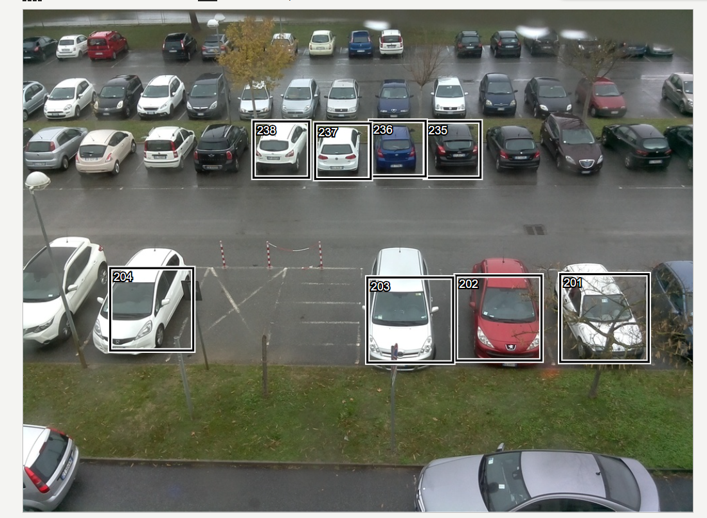

**Résultats sur les ensembles de réglage et de validation si la méthode produit déjà des décisions ; sinon, analyse des résultats intermédiaires / Tuning-set and validation-set results if the method already produces decisions; otherwise, intermediate-result analysis :**

**Performances selon la météo**

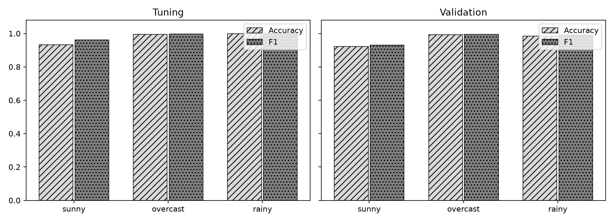

On voit qu'on a une légère difficulté à classer des voitures sur des espaces avec du soleil.

**Performances par journée**

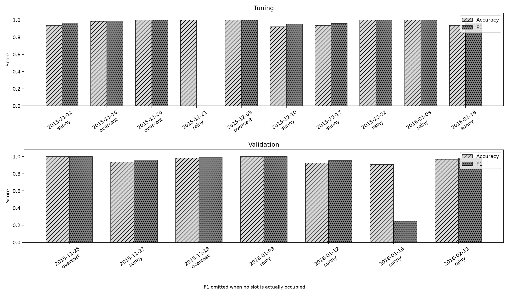

Évolution des performances selon la journée.

**Distribution des scores**

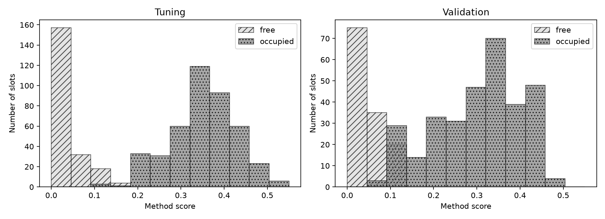

Les places libres ont généralement des scores plus faibles que les places occupées. Le chevauchement des distributions explique certaines erreurs de classification. On peut essayer de les régler avec une calibration plus sensible.

**Sensibilité au seuil de décision**

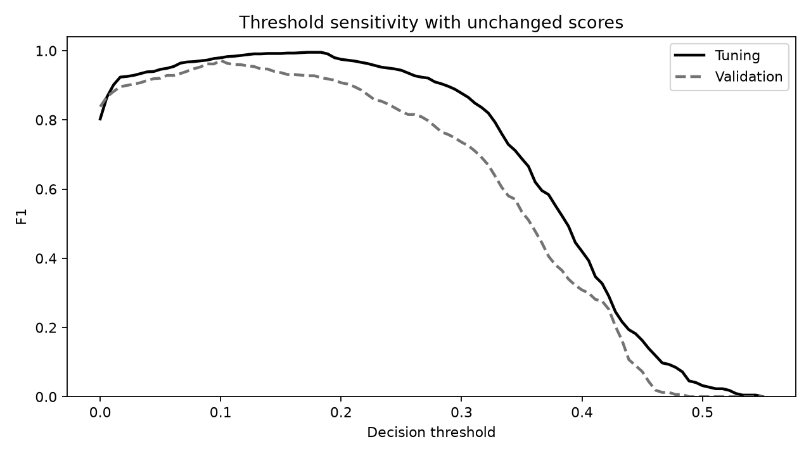

Cette courbe applique différents seuils aux scores sauvegardés, sans recalculer les méthodes gaussienne et de Sauvola.

**Exemples d'erreurs**

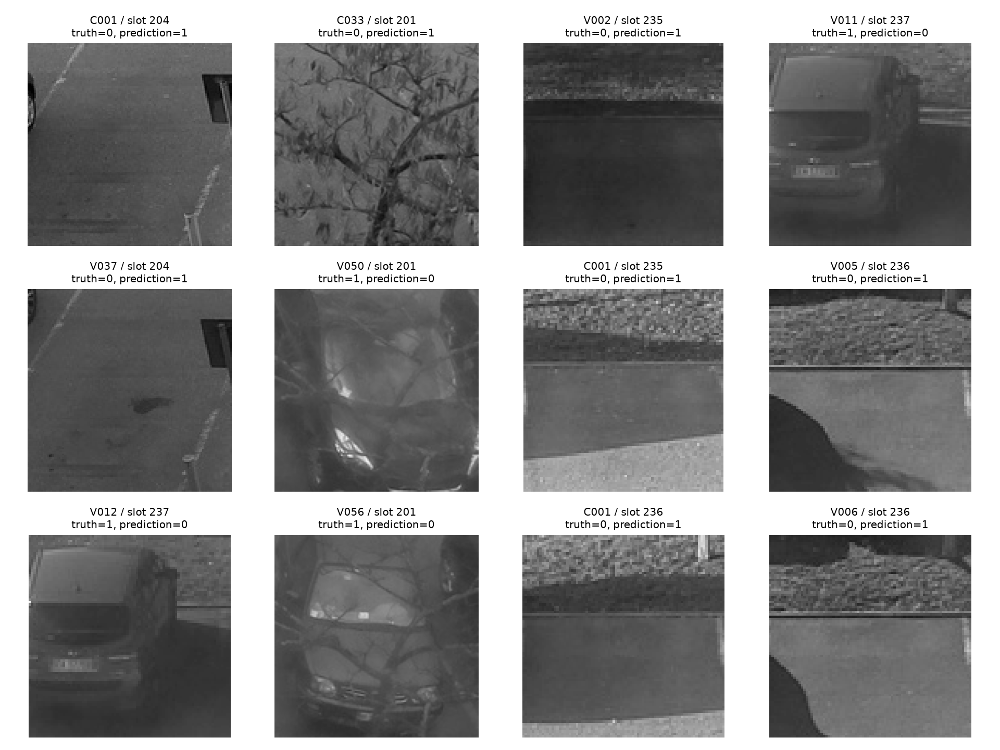

Chaque exemple indique l'image, la place, l'état réel et la prédiction. La valeur 0 correspond à une place libre et la valeur 1 à une place occupée. On peut se baser sur ces erreurs afin de chercher à améliorer nos méthodes.

**Résultat observé et situation difficile analysée (identifiants image/place), même si la chaîne reste incomplète / Observed result and analysis of a difficult situation (image and space IDs), even if the pipeline is unfinished :**

On analyse deux résultats sur deux situations difficiles sur les images V055 et V056. Sur l'image V056, l'algorithme se trompe et on a un faux négatif. On essaye de comprendre pourquoi.

**Première situation difficile — image V055**

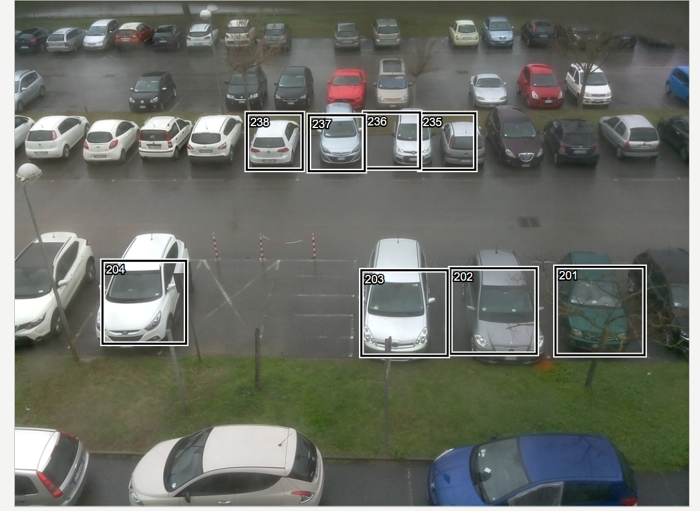

**Deuxième situation difficile — image V056**

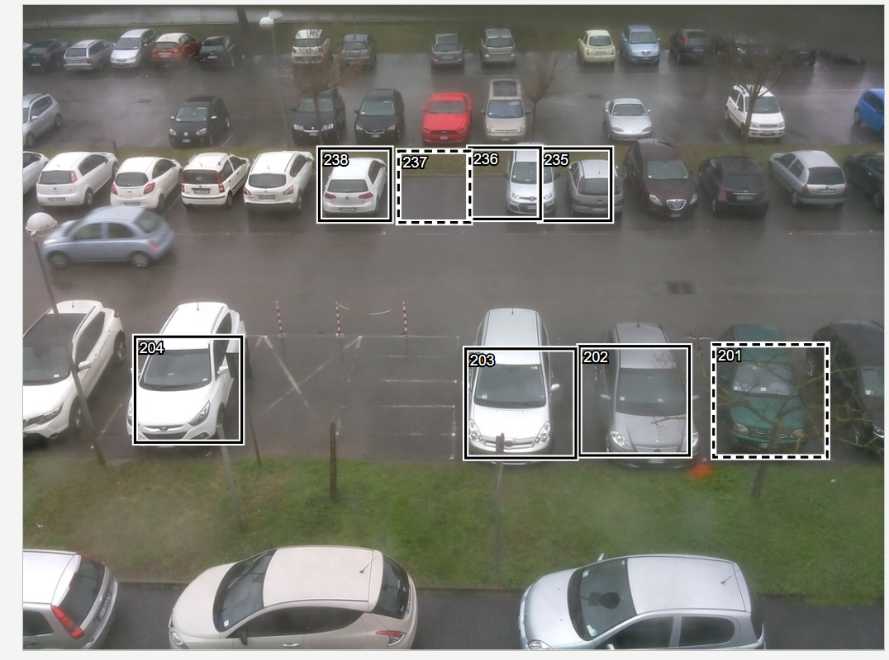

V056,201,2016-02-12,16:24,rainy,validation,0.079508,0

Les valeurs des scores calculés à la fin sont au-dessous du seuil pris, car l'arbre rend la décision difficile.

L'image V056 est une situation où le filtre gaussien arrive bien à détecter la voiture, mais le seuil de Sauvola n'y arrive pas. Donc, pour ça, il nous faut bien veiller à faire une calibration affinée des valeurs de la combinaison.

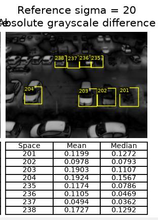

**Les résultats joints correspondent-ils au code déposé ? Sinon, précisez les différences / Do the attached results correspond to the submitted code? If not, explain the differences :**

Oui. On vous rappelle que le code le plus à jour et dans son intégralité reste disponible sur https://github.com/Zezinoo/TraitmentImages.

**Travail restant avant le rendu final / Work remaining before the final submission :**

On a essayé d'améliorer les paramètres comme le seuil de décision de l'ensemble de Sauvola et de la méthode gaussienne, ainsi que les indices donnés à chaque prédiction pour le score final.

On a fait un balayage des paramètres optimaux de la combinaison linéaire du seuil de Sauvola et de la méthode gaussienne pendant la séance, et on essaye de les réparer et de faire un graphe des variations.

## Contributions et assistance / Contributions and assistance

Précisez les contributions de chaque membre. Pour chaque usage d'un assistant IA, indiquez l'outil, la tâche, les fichiers ou passages concernés, ce qui a été repris ou modifié, et comment vous avez vérifié le résultat. Ajoutez une ligne à chaque nouvelle utilisation, y compris pendant le travail personnel. Si vous n'avez pas utilisé d'assistant IA, écrivez explicitement « aucune assistance IA ».

State each team member's contribution. For every use of an AI assistant, give the tool, task, affected files or report sections, what you retained or changed, and how you checked the result. Add a row for each new use, including work done after class. If you used no AI assistant, write "no AI assistance" explicitly.

| Moment / Stage | Membre / Team member | Travail réalisé / Work completed | Assistant IA et aide obtenue, ou « aucune » / AI assistant and help received, or "none" | Vérifications et modifications / Checks and changes |
|---|---|---|---|---|
| Séance 1 / Session 1 | | | | |
| Séance 2 / Session 2 | | | | |
| Après les séances / After class | | | | |
| Aide pendant les essais | À préciser | Visualisation des lissages et des différences ; compréhension des scores et des métriques. | Codex : aide à la modification de `test_blurring.py`, explications sur les splits, les statistiques par crop et les commandes de rapport. | Contrôles par l'assistant : exécution des visualisations sans interface, inspection des figures et calcul des métriques sur un CSV sauvegardé. Vérifications et modifications du binôme à compléter. |
| Mise en forme du journal | À préciser | Conversion du document PDF en `project-log.md` et intégration des sept figures. | Codex : organisation selon le modèle fourni, mise en forme Markdown, indentation du code et corrections de langue. | Contrôle de la structure, des liens vers les figures et de la syntaxe du bloc Python par l'assistant ; relecture du binôme à compléter. |

## Rendu final / Final submission

Le rendu final comprend une chaîne complète et reproductible et un rapport terminé. La souplesse des dépôts en séance concerne le travail en cours.

The final submission includes a complete, reproducible pipeline and a finished report. Flexibility at the classroom checkpoints concerns work in progress.

**Vérification de l'exécution sur toutes les images fournies, des scores finis et des décisions 0 ou 1 / Checks that the pipeline runs on all supplied images, returns finite scores, and outputs decisions of 0 or 1 :**

**Paramètres et bibliothèques nécessaires / Required parameters and libraries :**
scikit-image
numpy
scipy
pandas

**Nom de la méthode retenue et commande qui régénère les résultats / Selected method and command that reproduces the results :**
Seuil de Sauvola
Différence de gaussiennes
python run.py --method joint --name joint

**Écart entre le prototype de la seconde séance et le rendu final / Changes between the second-session prototype and final submission :**

**Limite principale que nous savons expliquer / Main limitation we can explain :**

On a une limite sur la détection des espaces non occupés qui ont de l'humidité sur le seuil.